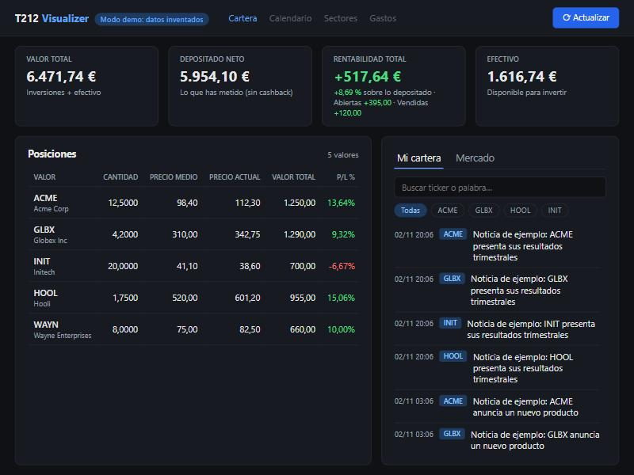
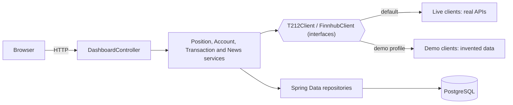

# T212 Visualizer

A personal portfolio dashboard for [Trading 212](https://www.trading212.com) accounts: positions, total account return and news about the companies you hold, on one screen.

> **Personal project, not affiliated with Trading 212. Not financial advice.**



*Demo mode, with invented companies and figures. The interface is in Spanish.*

## Try it in one minute

You only need Docker. Demo mode uses invented data, needs no API keys and never contacts Trading 212 or Finnhub.

```bash
docker compose -f docker-compose.demo.yml up --build
```

Then open <http://localhost:8081>. Stop it with:

```bash
docker compose -f docker-compose.demo.yml down
```

## Features

- **Positions:** quantity, average price, current value and P/L %, refreshed every 5 minutes or on demand.
- **Total account return:** account value minus net deposits, so it includes closed positions, dividends, interest and fees, not only open positions.
- **News:** market news and news about the US companies in your portfolio, with filters by ticker and text search.
- **Incremental sync:** account movements are stored in PostgreSQL, so after the first load only new ones are requested.

## Tech stack

Java 21, Spring Boot 3.3 (Web, Data JPA, Thymeleaf, Scheduling), PostgreSQL 16, Flyway, Docker Compose, JUnit 5 and Mockito.

## Architecture



The services depend on interfaces, and a Spring profile chooses the implementation. That is what makes demo mode possible and lets the tests replace the clients with mocks.

## Technical decisions

- **`BigDecimal` and `NUMERIC` for money.** `double` accumulates binary rounding errors when summing hundreds of movements.
- **Flyway instead of `ddl-auto: update`.** Schema changes are versioned SQL scripts that can also transform existing data. Hibernate only validates the schema at startup.
- **Incremental, all-or-nothing sync.** Movements arrive newest first, so the sync stops at the first known one. New ones are saved only after every page has been read, so an interrupted first load cannot leave a permanent gap.
- **Selective retries.** A `429 Too Many Requests` waits and retries the same page, up to 3 attempts. Other errors are not retried, because waiting would not fix them.
- **Honest loading states.** The return is hidden until the first sync after startup finishes, because stale movements would show a false figure.
- **Isolated demo.** Demo mode has its own in-memory database and does not create HTTP clients for the real APIs, so it cannot touch real data.

## Running it with your own account

You need a Trading 212 API key and secret, and a [Finnhub](https://finnhub.io) API key.

> **Security:** use a Trading 212 key **without order permissions**. The app has **no login**, so anyone who can reach it sees your portfolio. The compose file only publishes it on `127.0.0.1`. Do not expose it to the internet.

1. Copy the template and fill in your values:

   ```bash
   cp .env.example .env
   ```

2. Start the app and its database:

   ```bash
   docker compose up --build
   ```

3. Open <http://localhost:8080>. The first run downloads your whole movement history, which can take a few minutes.

To run it from an IDE instead, copy `src/main/resources/application-local.example.yml` to `application-local.yml` in the same folder, fill it in and start a local PostgreSQL with a `t212_viewdb` database.

## Tests

```bash
mvn test
```

The tests use JUnit 5 and Mockito, and need neither a database nor network access. They cover the sync algorithm (pagination, stopping at known movements, all-or-nothing, retries), P/L calculations, exact amount parsing and the consistency of the demo data.

## Known limitations

- **Pending card payments:** Trading 212 subtracts them from its net deposits straight away, but they do not appear in the API until they settle. Until then, the return shown here can be lower than the one in the app.
- **Cashback heuristic:** the API does not distinguish card cashback from real deposits, so deposits under 5 € are treated as cashback.
- **Percentage:** the return percentage is a simple division over net deposits, not time-weighted like the one in the Trading 212 app.
- **News:** company news only covers US stocks, because of the Finnhub free plan.
- **Single user:** one account per installation, with no login.

## Roadmap

- Economic calendar with dividends and earnings
- Sector view
- Expense tracking based on card payments
- Multi-user support with login

## License

[MIT](LICENSE)
