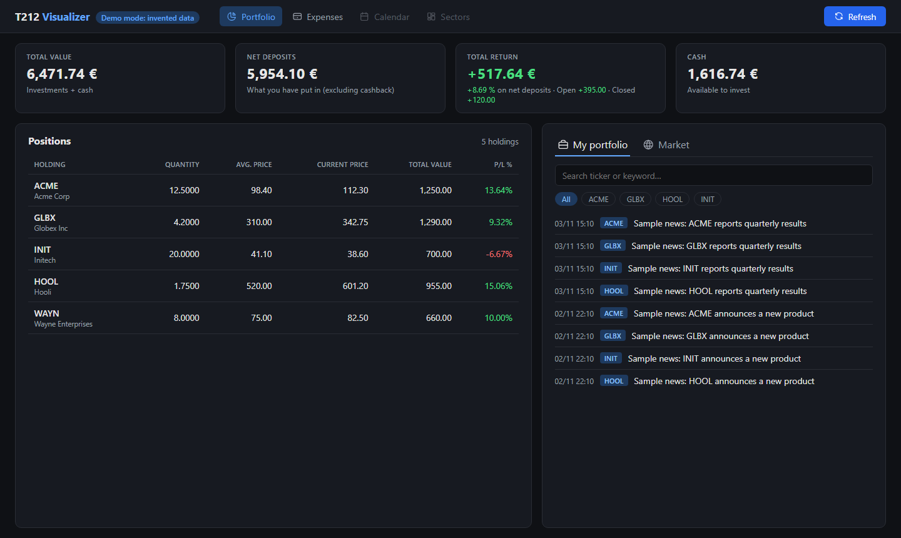
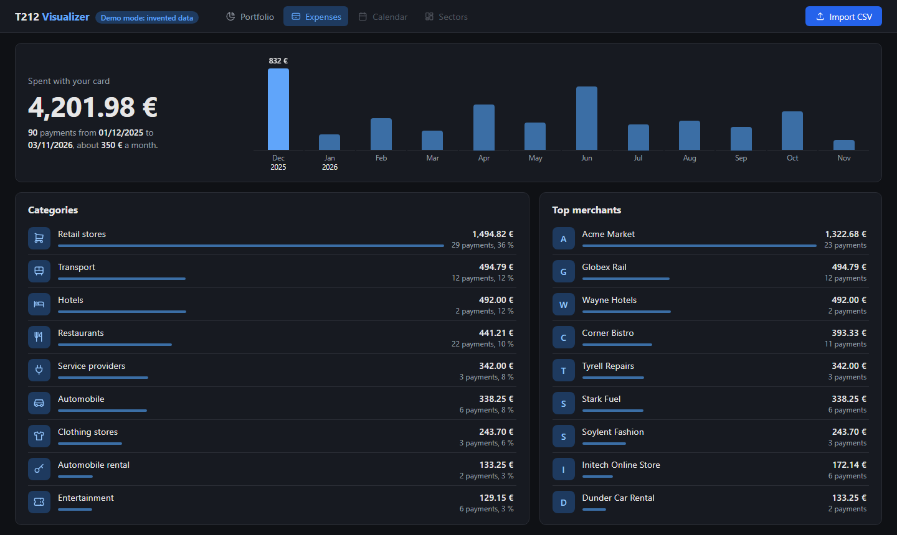
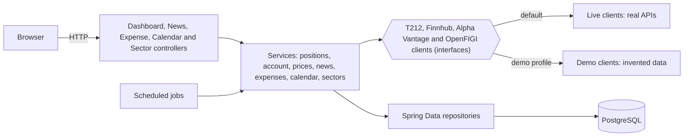

# T212 Visualizer

[](https://github.com/llijat/t212-visualizer/actions/workflows/ci.yml)

A personal dashboard for [Trading 212](https://www.trading212.com) accounts. It shows your positions and the real return of your account, the news and results of the companies you hold, the sectors they belong to and where your card money goes.

> **Personal project, not affiliated with Trading 212. Not financial advice.**





*Demo mode, with invented companies and figures.*

## Contents

- [Try it in one minute](#try-it-in-one-minute)
- [What it does](#what-it-does)
- [Running it with your own account](#running-it-with-your-own-account)
- [Configuration](#configuration)
- [What runs in the background](#what-runs-in-the-background)
- [Third-party services and your data](#third-party-services-and-your-data)
- [Architecture](#architecture)
- [Technical decisions](#technical-decisions)
- [Development](#development)
- [Known limitations](#known-limitations)
- [Roadmap](#roadmap)

## Try it in one minute

You only need [Docker](https://docs.docker.com/get-docker/). Demo mode uses invented data, needs no API keys and never contacts Trading 212, Finnhub or any other service.

```bash
docker compose -f docker-compose.demo.yml up --build
```

Open <http://localhost:8081>. Some figures fill in during the first minutes, as they would with a real account: the sector prices, for example, arrive about three minutes after starting. Stop it with:

```bash
docker compose -f docker-compose.demo.yml down
```

## What it does

### Portfolio

- **Account value:** the total, what you put in, and what you earned or lost, including closed positions, dividends, interest and fees.
- **Account chart:** the value of the account over 1 day, 1 week, 1, 3 or 12 months, or since the start, with its time-weighted return. The day and the week use a point every 15 minutes. Pointing at the chart reads the value and the money put in on that day.
- **Positions:** price with your average price below it, value with your shares below it, P/L in % or in euros, and a mini chart of the last week, month or 3 months that can also be sorted. Filter by text, gainers or losers.
- **Live chart:** a click on a position opens its [TradingView](https://www.tradingview.com) chart over the whole screen.
- **What's happening:** the holdings that move most today, gold and silver, the next results, and the latest headlines about what you hold.
- **Privacy mode:** one button blurs every amount in euros, for screenshots or showing the app to someone. Percentages stay.

### News

The last week of news about the US companies you hold and the market, grouped by day. Each source shows its own trend and today's move, and runs of three or more stories about the same company fold into one line. Search by text, and star a story to keep it for good. The others are deleted after 30 days.

### Expenses

Your card spending by month, category and merchant, with a heatmap of the days, monthly budgets, detected subscriptions and card cashback. Filter the payments by category or merchant, and create your own categories from any payment. New payments are imported once a day through the Trading 212 export API, and you can also upload an exported CSV by hand.

### Calendar

A month view with the quarterly results of the US companies you hold, before or after the market, the dividends on their payment day and your subscriptions on their due day. A side panel shows what comes up in the next two weeks, and the details of any event: revenue and EPS against the estimates, or the dividend you received.

### Sectors

A map of the market in 11 sectors and 32 subsectors, each followed through an ETF (SMH for semiconductors, KBE for banks and so on). Each tile is sized by its weight in the S&P 500, or by your money in it, and coloured by today's move.

- Tiles where you hold stocks have a blue ring, and "My holdings" fades the rest.
- A strip above the map lines up every subsector from the worst to the best of the day.
- The column beside it compares your sectors with the market, shows your subsectors as bars around zero, and how your money is split by sector.
- A click on a tile shows its move, how much you have there, what it made or lost today, and your stocks in it, each linking to your portfolio already filtered.

### Across the app

- **Dividends:** the announced ones, with their ex-dividend date, and the real amount you received in euros. Until a dividend is paid, the app estimates it from your shares and your last payment of that stock, so the estimate already includes tax and the exchange rate.
- **Company logos:** downloaded once and served by the app itself. Holdings without a logo show their initial.
- **Current tickers:** Trading 212 keeps some old tickers (FB for Meta, UTX for RTX). The app looks up the current one by ISIN and uses it everywhere.
- **Price history:** the closing price of every US holding and every sector ETF is saved each day, and the missing past month of a new holding is filled in from Alpha Vantage.

## Running it with your own account

### What you need

- A Trading 212 **API key and secret**, created in the Trading 212 app under *Settings → API*. Give it **only read permissions, never orders**.
- A [Finnhub](https://finnhub.io/register) API key and an [Alpha Vantage](https://www.alphavantage.co/support/#api-key) API key. Both have a free plan, which is enough.
- Docker, or Java 21 and PostgreSQL 16 to run it without Docker.

> **Security:** the app has **no login**, so anyone who can reach it sees your portfolio. The compose file only publishes it on `127.0.0.1`. Do not expose it to the internet. To reach it from other devices, use a private network such as [Tailscale](https://tailscale.com) instead of opening a port.

### With Docker (recommended)

1. Clone the repository:

   ```bash
   git clone https://github.com/llijat/t212-visualizer.git
   cd t212-visualizer
   ```

2. Copy the template and fill in your values. The database user and password are yours to choose: they are created on the first start.

   ```bash
   cp .env.example .env
   ```

3. Start the app and its database:

   ```bash
   docker compose up --build -d
   ```

4. Open <http://localhost:8080>.

The first run downloads your whole movement history, which can take a few minutes. Company names, logos, prices and sectors fill in during the first quarter of an hour.

Useful commands:

```bash
docker compose logs -f app       # what the app is doing
docker compose down              # stop it (your data stays in the db-data volume)
git pull && docker compose up --build -d   # update to the latest version
```

`docker compose down -v` also deletes the database volume, and with it the price history, the account chart and your starred news, budgets and categories.

### Without Docker (from an IDE or the command line)

1. Create a PostgreSQL 16 database called `t212_viewdb`, and a user that owns it.
2. Copy `src/main/resources/application-local.example.yml` to `application-local.yml` in the same folder and fill it in. That file is ignored by git.
3. Start the app with the `local` profile, which is the default:

   ```bash
   mvn spring-boot:run
   ```

Flyway creates and updates the tables on every start. Open <http://localhost:8080>.

## Configuration

Credentials go in `.env` (Docker) or `application-local.yml` (without Docker). Neither file is committed.

| Variable | What it is |
|---|---|
| `DB_USERNAME`, `DB_PASSWORD` | The PostgreSQL user and password |
| `T212_API_KEY`, `T212_API_SECRET` | Your Trading 212 API key and secret, read-only |
| `FINNHUB_API_KEY` | Your Finnhub key: news, results, logos, prices of the day |
| `ALPHA_VANTAGE_API_KEY` | Your Alpha Vantage key: announced dividends and past prices |

Other settings live in `src/main/resources/application.yml`. The defaults fit the free plans:

| Setting | Default | What it does |
|---|---|---|
| `app.zone` | `Europe/Madrid` | Time zone for days, times and charts |
| `finnhub.request-delay-ms` | `1000` | Pause between price requests, to stay under 60 a minute |
| `alpha-vantage.backfill-per-day` | `15` | Daily requests for past prices of new holdings |
| `alpha-vantage.stocks-per-day` | `10` | Daily requests for announced dividends |
| `alpha-vantage.request-delay-ms` | `13000` | Pause between requests, to stay under 5 a minute |
| `t212.sync.page-delay-ms` | `3500` | Pause between pages of movements, as Trading 212 limits them |

The two Alpha Vantage budgets share the 25 requests a day of the free plan.

## What runs in the background

The app refreshes everything on its own while it is running. The price history and the account chart only grow while the app is on: a computer that sleeps leaves gaps.

| Every | What |
|---|---|
| 5 minutes | Positions, account summary and new account movements |
| 15 minutes | Prices of the day for your US holdings, gold, silver and the 32 sector ETFs; a point of the account chart; news |
| 1 hour | Results published in the last days |
| 6 hours | Announced dividends, dividends received, and past prices for new holdings |
| 12 hours | Upcoming results |
| 1 day | Company names, logos, tickers and industries; card payments; news older than 30 days are deleted |

## Third-party services and your data

The app's server is what contacts these services, and this is what each one receives:

| Service | What it receives | What for |
|---|---|---|
| [Trading 212](https://www.trading212.com) | Your API key and secret | Positions, account summary, account movements and card payment reports |
| [Finnhub](https://finnhub.io) | Your API key, the tickers of your US holdings and the 32 sector ETFs | News, results, company names, logos and industries, and prices of the day |
| [OpenFIGI](https://www.openfigi.com) | The ISINs of all your holdings | The current ticker and exchange of each one |
| [Alpha Vantage](https://www.alphavantage.co) | Your API key and the tickers of your US holdings, up to 25 a day | Announced dividends and past closing prices |

None of them receives quantities, prices or amounts. A list of tickers or ISINs does reveal **which** companies you hold, so do not use the app if that is a problem for you.

**TradingView** is the one exception that your browser contacts directly: when you open the chart of a position, the browser loads TradingView's page for that stock, so TradingView sees your IP address and which stock you opened. It loads only on that click, isolated from the app, and nothing loads in privacy mode.

Report downloads go to the storage link that Trading 212 provides, without your credentials. Company logos are downloaded by the server and stored in the database, so viewing a page never sends a request to a logo service.

## Architecture



The services depend on interfaces, and a Spring profile chooses the implementation. That is what makes demo mode possible and lets the tests replace the clients with mocks. Pages are rendered on the server with Thymeleaf; the charts and the sector map are drawn in plain JavaScript, without chart libraries.

**Tech stack:** Java 21, Spring Boot 3.3 (Web, Data JPA, Thymeleaf, Scheduling), PostgreSQL 16, Flyway, Docker Compose, JUnit 5 and Mockito.

## Technical decisions

- **`BigDecimal` and `NUMERIC` for money.** `double` accumulates binary rounding errors when summing hundreds of movements.
- **Flyway instead of `ddl-auto: update`.** Schema changes are versioned SQL scripts that can also transform existing data. Hibernate only validates the schema at startup.
- **Incremental, all-or-nothing sync.** Movements arrive newest first, so the sync stops at the first known one. New ones are saved only after every page has been read, so an interrupted first load cannot leave a permanent gap.
- **Selective retries.** A `429 Too Many Requests` waits and retries the same page, up to 3 attempts. Other errors are not retried, because waiting would not fix them.
- **Requests paced to the free plans.** Prices wait a second between them, and Alpha Vantage requests 13 seconds, with a daily budget counted in memory, so the app never hits a limit in normal use.
- **Time-weighted return on the chart.** The account chart measures how the investments did, whatever money came in or out, by chaining the growth between points. The headline figure stays the plain "earned or lost" in euros.
- **One closing price per symbol and day.** The price history has a composite key, so saving the same day again only updates it, and the 15-minute refresh can write freely.
- **Sectors from a hand-written catalogue.** Finnhub's industry names are mapped to 32 subsectors, with exceptions for large companies it files somewhere less useful (Apple as hardware, Visa as payments). An industry nobody mapped goes to "Other" and is logged once.
- **Honest loading states.** The return is hidden until the first sync after startup finishes, because stale movements would show a false figure. Sectors say when their prices have not arrived yet.
- **Isolated demo.** Demo mode has its own in-memory database and does not create HTTP clients for the real APIs, so it cannot touch real data.
- **Expenses from the CSV export.** The API returns card payments without merchant or category, and does not separate them from bank withdrawals, so they come from the CSV export instead. Columns are read by name because they change between exports, and each payment's ID makes importing overlapping files safe.
- **No credentials on report downloads.** Report download links point outside Trading 212, so they use a separate HTTP client without the API key. The signed links are never written to the logs.
- **A small design system.** One stylesheet holds the type scale, corner radii, category colours and shared controls, so every page looks like the same app. Nothing clickable is under 24 px, and text keeps at least 4.5:1 contrast.

## Development

```bash
mvn test
```

There are 522 tests with JUnit 5 and Mockito, and they need neither a database nor network access. GitHub Actions runs them and builds the Docker image on every push. They cover the sync algorithm (pagination, stopping at known movements, all-or-nothing, retries), returns and P/L, the price history and its backfill, the sector catalogue and map, CSV import, the expense summary, the calendar, the controllers and the consistency of the demo data.

To work on the pages with invented data, start the app with the `demo` profile and a throwaway PostgreSQL:

```bash
docker run -d --rm --name t212-demo-db -e POSTGRES_USER=demo -e POSTGRES_PASSWORD=demo \
  -e POSTGRES_DB=t212_demo -p 5433:5432 --tmpfs /var/lib/postgresql/data postgres:16
SPRING_PROFILES_ACTIVE=demo SERVER_PORT=8082 mvn spring-boot:run
```

Open <http://localhost:8082>. Templates are cached, so restart the app to see a change. Stop the database with `docker stop t212-demo-db`: it lives in memory and leaves nothing behind.

## Known limitations

- **Pending card payments:** Trading 212 subtracts them from its net deposits straight away, but they do not appear in the API until they settle. Until then, the return shown here can be lower than the one in the app.
- **Cashback heuristic:** the API does not distinguish card cashback from real deposits, so deposits under 5 € are treated as cashback. This can misclassify the odd movement, so net deposits can differ slightly from the Trading 212 figure.
- **Expenses:** payments appear once they settle, and the automatic import only runs while the app is on. A reverted payment never appears in the export, so it does not count.
- **US stocks only, for some data:** news, prices of the day, mini charts, logos, results and announced dividends come from free plans that only cover US stocks. Other holdings show their initial, and their dividends appear once they are paid.
- **Prices of the day:** refreshed every 15 minutes, without pre-market or after-hours trading. Outside the New York session (15:30 to 22:00 in Spain) they show the last session. The change is in the stock's own currency, so it can differ from a change in euros.
- **Metals:** gold and silver come through the GLD and SLV funds, so only their daily change is shown: a fund share holds a fraction of an ounce, so its price is not the price of the metal.
- **Sectors:**
  - Each subsector is followed through one ETF, and some ETFs cover the whole sector (XLK, XLC, XLI, XLP), so they are an approximation.
  - The weights in the S&P 500 are written by hand and need a review every few months.
  - Non-US holdings have no industry, so they go to "Other".
  - Only the day is shown for now: 1W and 1M appear once enough prices are saved, and YTD needs the close of 31 December.
- **History while running:** the account chart and the price history only grow while the app is on.
- **Single user:** one account per installation, with no login.

## Roadmap

- Sectors over 1 week, 1 month and the year to date
- Valuation of each holding (P/E against its sector, Graham number, simple DCF)
- Multi-user support with login

## License

[MIT](LICENSE)
